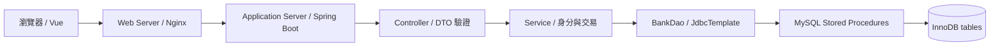

# 玉山 E.SUN Select｜金融商品喜好紀錄系統

以既有 Java 21、Spring Boot 3.5.11、Maven 與 Vue 專案完成的繁體中文金融商品喜好系統。提供 Email 註冊／登入、商品探索、搜尋排序、喜好 CRUD、費用試算及手機版介面。資料庫存取全部使用 Spring JDBC 呼叫 MySQL Stored Procedure，未使用 JPA CRUD。

商品與價格均為展示資料；收藏不會申購，也不會進行實際扣款。附件提及的原始實作題 PDF 未提供，因此需求對照以 Markdown 文件所列內容為準。

## 快速啟動

需要 Java 21、Maven 3.9+、Node（符合 frontend/package.json engines）與 MySQL 8.0.16+。

1. 安裝並啟動 MySQL，預設測試帳密為 `root` / `123456`（可用 `DB_USERNAME`、`DB_PASSWORD` 覆蓋）。
2. 執行 `mvn spring-boot:run`，或從 IDE 啟動 `TestesunbankApplication`（需先建置前端）。Spring Boot 會在建立 DataSource 時自動建立 DB_URL 指定的資料庫，載入內含的 SQL，呼叫 `sp_initialize_database()` 建立缺少的資料表及展示商品，並安裝會員、商品與收藏程序。無需手動執行 SQL 或使用 ps1。
3. 開啟 [註冊頁](http://localhost:8080/#/register)。會員 ID 由資料庫產生流水號。

每次啟動會檢查資料表並更新程序，保留既有會員、收藏及商品內容。初始化錯誤會中止啟動。初始化在處理請求之前完成，不會在會員／收藏交易內執行 DDL。MySQL 帳號需具備建庫、建表、寫入展示資料及建立程序權限。已由管理員配置資料庫、只使用 EXECUTE 權限帳號時，可設 `DB_INITIALIZE=false` 關閉自動初始化。

SQL 原始檔在 `DB/Procedures/`，Maven 會將它們包進 JAR，執行 JAR 時也會自動初始化。`start.ps1` 只是可選的建置／啟動捷徑。手動初始化仍可使用 `SOURCE DB/init.sql;`。

若 8080 已被其他服務使用，可先設定 `$env:PORT='8081'`，並開啟對應網址。

### 前後端分開開發

```powershell
# 終端一：先設定 DB_USERNAME / DB_PASSWORD（勿將真實值提交 Git）
mvn spring-boot:run '-Dskip.installnodenpm=true' '-Dskip.npm=true'

# 終端二
cd frontend
npm ci --include=dev
npm run dev
```

Vite 預設透過同源 `/api` proxy 轉送至 localhost:8080；需要使用自訂後端 port 時修改 `vite.config.ts`。Cookie 與 CSRF 均走同源，不需放寬 CORS。前端用 hash router，正式靜態主機不需配置各頁面的路由轉送。

### 建置與環境設定

```powershell
mvn package
java -jar target/Testesunbank-0.0.1-SNAPSHOT.jar
```

Maven 的 frontend-maven-plugin 會安裝 Node、執行 npm ci/build，再由 resources plugin 將 frontend/dist 複製至 Spring Boot static。前端已手動建置時，可用 `mvn package '-Dskip.installnodenpm=true' '-Dskip.npm=true'` 避免重複安裝。

| 環境變數 | 預設 | 用途 |
|---|---|---|
| DB_URL | jdbc:mysql://localhost:3306/esun?serverTimezone=Asia/Taipei&characterEncoding=UTF-8 | MySQL JDBC 連線 |
| DB_INITIALIZE | true | 啟動時自動初始化資料庫 |
| DB_USERNAME | root | 資料庫使用者 |
| DB_PASSWORD | 123456 | 本機測試預設，可透過環境變數覆蓋 |
| PORT | 8080 | 應用程式 port |
| COOKIE_SECURE | false | HTTPS 部署設為 true |
| RUN_DB_TESTS | 未設定 | true 時執行實際 MySQL 整合測試 |
| TEST_BASE_URL | http://localhost:8080 | Playwright 被測服務 |

原本 `config/application.properties` 含固定帳密，已移除，主要設定改放 `src/main/resources/application.properties`。正式部署請配置 HTTPS、Secure Cookie、受限 DB 帳號與網路存取；目前為本機作業版本，沒有 Email 所有權驗證、扣款帳號實名驗證、登入限流或 MFA。

## 架構與需求對照



本機可由 Spring Boot 同時提供 Vue 靜態檔與 API；三層部署可依 `config/nginx.conf.example` 將靜態頁交由 Nginx、API 交由 Spring Boot、資料交由獨立 MySQL。Nginx 範例未實際部署，TLS 憑證與主機位置需依環境設定。

| 需求 | 對應實作 |
|---|---|
| 新增、查詢、修改、刪除喜好 | LikeListController → LikeListService → BankDao → procedures |
| 展示／業務／資料／共用層 | Controller、Service、dao、common；Model 為一般 Java 類別，DTO 驗證輸入 |
| Stored Procedure 資料存取 | 所有應用 SQL 為固定 CALL + 綁定參數；BankDao 不是 Spring Data Repository |
| 跨表 Transaction | like_list 與 like_events 在 Service 的同一個 @Transactional 邊界異動 |
| 資料隔離 | userId 來自伺服器 Principal；所有喜好 procedure 都以 user_id 限定 |
| SQL Injection／XSS | 無動態 SQL；Vue 文字插值跳脫，無 v-html |
| 登入保護 | Spring Security Session、BCrypt、CSRF、登入換 Session ID、登出銷毀 Session |
| Web／App／DB 三層 | Nginx 範例 + Spring Boot + MySQL，另提供單機展示方式 |
| DDL／DML | DB/01_schema.sql、02_seed.sql、Procedures、init.sql |

沿用既有 package 根目錄與現有大寫 `Controller`、`Service`、`Model`、`DTO` 資料夾，修正宣告不一致。既有 `user`、`product`、`likelist` 表不具備新版外鍵與會員密碼，因此保留原表，新增 `users`、`products`、`like_list`、`like_events`；舊資料未自動遷移。若需遷移，應先核對舊帳號對應與商品關聯並備份。

## 資料模型與金額定義

- users：會員 ID 主鍵、姓名、Email 唯一、本人扣款帳號、BCrypt 密碼雜湊。Email 為登入識別，會轉小寫。帳號為註冊者自行填入的展示資料。
- products：商品編號、名稱、DECIMAL 單價與費率。`0.015` 表示 1.5%。商品價格限制 0 < price ≤ 1,000,000,000、費率 0–1。
- like_list：流水號、會員／商品外鍵、數量、本人帳號、儲存當時的總費用與含費用總額。數量 1–1,000,000。可多次收藏同一商品，代表不同的數量規劃。
- like_events：新增／修改／刪除操作紀錄。保留已刪除喜好 SN，因此不對 like_list 建外鍵。事件與會員有外鍵。

```text
小計 = 資料庫商品單價 × 購買數量
手續費 = ROUND(小計 × 資料庫費率, 2)
預計扣款總額 = 小計 + 手續費
```

例如單價 1,250、數量 2、費率 1.5%：小計 2,500、手續費 37.50、含費總額 2,537.50。資料庫 DECIMAL 為最終依據，Java 使用 BigDecimal；前端 Number 僅供即時預估。儲存時不接受前端價格、費率、帳號、總額或 userId。

修改喜好時重新取得資料庫單價與費率。若管理員另外調整商品價格，既有喜好總額仍為最後儲存的試算值，編輯儲存後才會更新。系統不包含商品維護或真實交易功能。

## Stored Procedure 契約

所有參數均為 IN；喜好 procedure 不自行 START/COMMIT，Spring 掌管交易。新增／修改會鎖定讀取會員與商品資料，修改喜好以 FOR UPDATE 鎖定該筆。

| Procedure | 參數順序 | 回傳／錯誤 |
|---|---|---|
| sp_register_user | 姓名、Email、帳號、密碼雜湊 | 回傳含自動編號的會員；Email 衝突轉 409 |
| sp_get_user_by_email | Email | 0 或 1 筆會員；密碼雜湊只供內部驗證，JSON 排除 |
| sp_get_products | 無 | 商品清單 |
| sp_get_like_list_by_user | userId | JOIN 商品與會員的喜好清單 |
| sp_get_like_list_item | userId、SN | 內部新增／修改回傳單筆使用 |
| sp_create_like_list | userId、productNo、quantity | 新增後的喜好資料 |
| sp_update_like_list | userId、SN、productNo、quantity | 更新後的喜好資料，相同數量仍合法 |
| sp_delete_like_list | userId、SN | 無結果 |
| sp_record_like_event | userId、SN、action | 無結果；Service 與喜好異動共用交易 |

Procedure 預期錯誤使用 SQLSTATE 45000：MYSQL_ERRNO 30001 → 404 找不到商品／喜好／會員，30002 → 400 數量錯誤。不屬於會員的 SN 與不存在 SN 都回 404。資料庫不可用回 503，不洩漏 SQL、連線或密碼。

## REST API

| 方法 | 路徑 | 成功回應 |
|---|---|---|
| GET | /api/auth/csrf | 200，token 與 headerName |
| POST | /api/auth/register | 201，會員資料 |
| POST | /api/auth/login | 200，會員資料並設定 Session |
| GET | /api/auth/me | 200，目前登入會員 |
| POST | /api/auth/logout | 204 |
| GET | /api/products | 200，商品陣列 |
| GET | /api/likes | 200，目前會員喜好陣列 |
| POST | /api/likes | 201，新增資料 |
| PUT | /api/likes/{sn} | 200，更新資料 |
| DELETE | /api/likes/{sn} | 204 |

成功回傳資源 JSON／陣列，錯誤統一 `{ "message": "可讀訊息" }`。無登入 401、CSRF 無效 403、DTO 格式錯誤 400、重複會員 409。

註冊：

```json
{"userName":"王小明","email":"member@example.com","account":"123456789012","password":"choose-your-own-password"}
```

新增或修改喜好：

```json
{"productNo":1,"purchaseQuantity":2}
```

呼叫順序：先 GET /api/auth/csrf，保留回傳的 Session Cookie；POST/PUT/DELETE 需以 headerName 指定的標頭帶入 token。登入後 Session ID 與 CSRF 會更新，下一次寫入前重新取得 token。Vue 的 services/api.ts 已封裝，Cookie 為 HttpOnly、SameSite=Lax，30 分鐘未使用失效。勿僅以 email/userId 模擬登入。

## 測試與驗收

```powershell
# 不需資料庫：啟動、安全、輸入驗證、密碼服務測試
mvn test '-Dskip.installnodenpm=true' '-Dskip.npm=true'

# 實際 MySQL（設定 DB_USERNAME / DB_PASSWORD；啟動測試時自動初始化）
$env:RUN_DB_TESTS='true'
mvn test '-Dskip.installnodenpm=true' '-Dskip.npm=true'

cd frontend
npm run build
npm run test:unit -- --run
# 先啟動真實後端，再執行；本機使用已安裝 Edge，無 API mock
npm run test:e2e
```

MySQL 測試使用隨機會員，會回滾測試交易；檢查 CRUD、相同數值修改、帳號隔離、費用精度、稽核紀錄與回滾。另以稽核失敗的方式驗證 Service 將交易標為回滾。Playwright 使用實際註冊與 CRUD，會留下 `ui` 開頭的測試會員與操作紀錄，喜好資料最後刪除。建議在獨立測試資料庫執行。

畫面截圖輸出於 artifacts/，測試結果詳見 [驗收紀錄](TESTING.md)。三層主機部署、HTTPS 與正式環境權限需另依實際環境驗證。

若 `mvn clean` 因 target/node/node.exe 被占用，先停止本專案的 Maven／Node 服務再重試；不要刪除 src 或 DB。提交 Git 前檢查沒有 `.env`、密碼、資料庫備份或 target/node_modules/dist 等產物；本專案未自動建立 commit 或推送遠端。

註冊會員 ID 由資料庫流水號自動產生，註冊 API 不接受自訂 userId。啟動專案時會自動安裝對應的初始化及會員程序；也可手動使用 DB/init.sql。既有會員 ID 與收藏關聯保持不變；流水號可能因交易回滾產生跳號。

## 初學者閱讀順序

後端使用一般 Java 類別、建構子注入、getter／setter 及 if 判斷。先看 `Controller/ProductController.java` → `Service/ProductService.java` → `dao/BankDao.java`，理解「接收請求 → 處理邏輯 → 呼叫資料庫」；再看會員與收藏流程。

- `DTO`：接收前端 JSON，使用 `@NotBlank` 等註解檢查資料。
- `Model`：保存資料庫結果；`BeanPropertyRowMapper` 透過 setter 將欄位填入物件。
- `Controller`：指定 API 網址，呼叫 Service。
- `Service`：處理密碼與收藏邏輯；`@Transactional` 讓同一次操作一起成功或一起回滾。
- `dao`：用 `JdbcTemplate` 呼叫 Stored Procedure，問號由參數帶入。
- `config/DatabaseConfig`：啟動時建立資料庫並執行 SQL，SQL 仍放在 `DB/Procedures`。
- `config/SecurityConfig`：登入、Session、CSRF 與網址權限設定；其中 Lambda 是 Spring Security 的設定方式。
- `common/GlobalExceptionHandler`：統一將錯誤轉為前端可讀的訊息。

會員密碼不會出現在 JSON；資料查詢仍依登入身分隔離。前端 Vue 與資料庫結構沿用既有功能。
